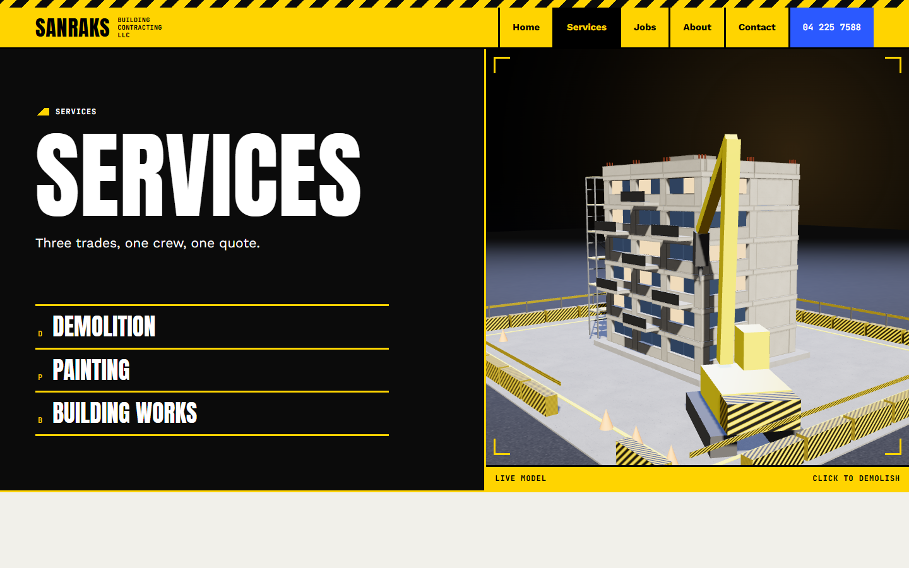
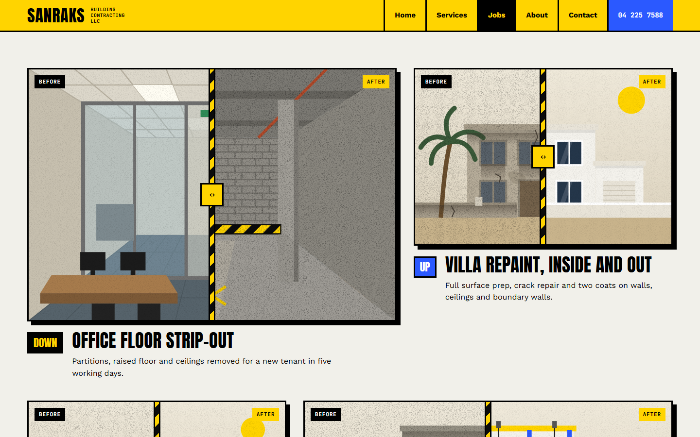
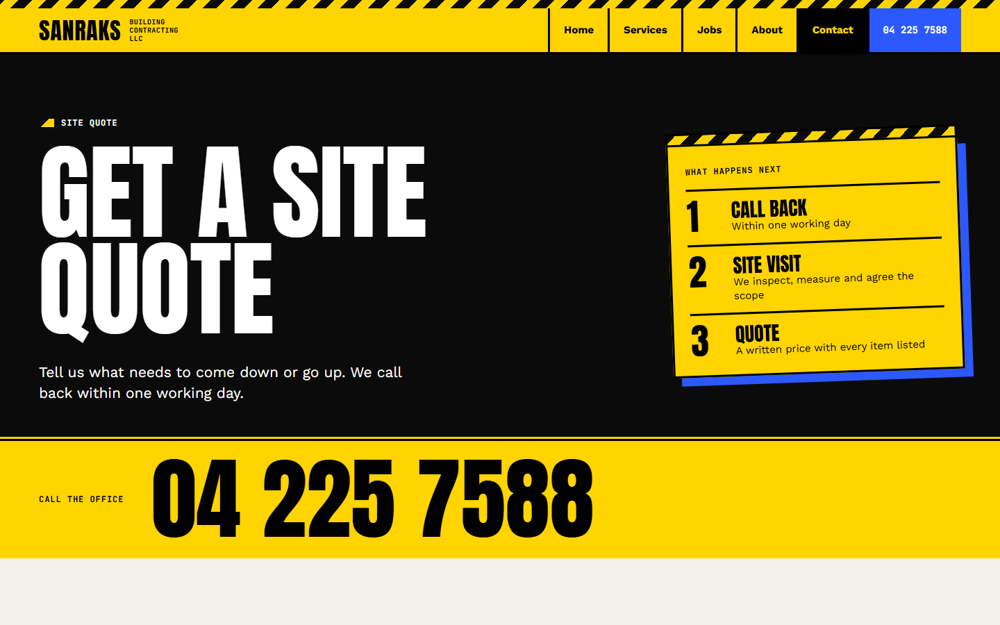

# SANRAKS Building Contracting LLC

A bold, industrial multi-page static concept website for **SANRAKS Building Contracting LLC**, a Dubai contractor handling **demolition, interior strip-outs, painting, and building repair works** from Festival City, Ras Al Khor, Dubai.

Styled as a brutalist **site sheet** in hazard yellow, pitch black, concrete grey and signal blue (`Anton` + `Work Sans` + `JetBrains Mono`), the home page is a pinned, scroll-driven 3D story: a concrete tower is stripped out, broken down floor by floor with hand-rolled rubble physics, prepped under scaffold and rolled in fresh paint.

---

## Screenshots

### Desktop — Interactive 3D Demolition & Paint Hero


### Pages & Responsive Views

| Services | Jobs Showcase |
| :---: | :---: |
|  |  |

| Get a Site Quote | Mobile (`375×812`) |
| :---: | :---: |
|  |  |

<details>
<summary>View Full Landing Page Screenshot</summary>


</details>

---

## Key Features

- **Cinematic Three.js demolition scene (`assets/js/scene.js`)** — vendored **Three.js r128**, no other libraries:
  - Detailed tower built from ~400 instanced chunks: column segments, split floor slabs, spandrels, side walls, balconies with rails, a dark core, roof parapet and rusty rebar stubs, plus glazing panes with randomly lit interiors.
  - Site dressing: hazard-striped jersey barriers with taped posts, cones, a floodlight mast, line markings, a long-reach demolition excavator (2-link IK boom + breaker), a scaffold on the west face and a paint-roller gondola on the south face.
  - Procedural canvas textures (concrete, asphalt, hazard stripes, backdrop) and a custom chunk shader: triplanar concrete in chunk space, darkened chunk edges, and two paint layers split by the roller's height.
  - Hard warm key light with soft PCF shadows, cool hemisphere fill and a signal-blue rim light, ACES tone mapping. On desktop, a hand-written post pass (multisampled `WebGLRenderTarget` + `ShaderMaterial`) adds vignette, film grain and shake-driven chromatic aberration.
  - **Demolish** (`[data-demolish]` or click the tower): the breaker arm strikes, the tower shudders, then floors release top-down with simple physics (gravity, bounce, friction, tumble, settle flat onto a heightfield so rubble piles up). Dust particle bursts and a short camera shake follow.
  - **Rebuild and paint** (`[data-rebuild]`): chunks arc back and snap in floor by floor, glazing slides back in, then a roller descends the facade and the paint colour rolls down with a wet edge. Repeated clicks cycle the five swatch colours. Live status in `[data-demo-status]` (`aria-live`).
  - Inner pages use lighter scenes: auto-repaint with scaffold (Services), demolish/rebuild cycle (About), and a rubble pile you can rebuild (404).
  - Performance: rendering pauses when the canvas is off-screen (IntersectionObserver) or the tab is hidden; DPR capped at 2 (1.5 on small screens); small screens get fewer floors, chunks and dust particles, no shadows and no post pass.
- **Scroll story on the home page (`assets/js/main.js` + scene)**: the 3D stage is pinned while five steps pass (Site, Strip-out, Demolition, Prep, Paint). Scroll drives the camera orbit and the scene: glazing is stripped, the arm reaches in and demolishes, the tower is rebuilt bare with scaffold rising, then rolled in signal blue. Brutalist motion: slab wipes, a hard-cut phase counter, a progress rail and ticker tape.
- **Before / after gallery (`projects.html`)**: six SVG illustrations (raw or fitted-out vs cleared or painted) with a draggable hazard-striped wipe, keyboard-accessible range control and Down / Up filters.
- **Loading screen and page transitions**: a 1.1 s CSS-only 3-2-1 hazard countdown on the first visit of a session, and a hazard shutter wipe between pages. Both are pointer-transparent and never block if JavaScript fails.
- **Accessibility**: `prefers-reduced-motion` turns off the loader, transitions, camera motion, shake and dust (demolish and rebuild become instant state changes); thick visible focus rings; `aria-live` status; Escape closes the mobile menu.
- **No-WebGL fallback**: a static SVG illustration of the half-painted tower replaces each canvas.
- **Validated Site Quote Form (`assets/js/main.js`)**: client-side validation with accessible `aria-live` feedback (unchanged behaviour).
- **Zero Build Step**: pure HTML5, CSS3 and vanilla JavaScript.

---

## Pages Included

| File | Page | Highlights |
| :--- | :--- | :--- |
| `index.html` | **Home** | Pinned 3D scroll story (strip-out, demolition, prep, paint), demolish/rebuild controls, Down vs. Up trades, safety grid, expanding paint chips |
| `services.html` | **Services** | Auto-repainting 3D scene, Demolition / Painting / Building works sections |
| `projects.html` | **Jobs** | Before/after wipe gallery of six sample jobs with Down / Up filters |
| `about.html` | **About** | Demolish/rebuild 3D scene, who we are, 5-step job timeline |
| `contact.html` | **Get a site quote** | Festival City office details, quote request form, embedded Google Map |
| `404.html` | **Not Found** | Rubble scene you can click to rebuild (`Nothing here`) |

---

## Design System & Typography

- **Fonts**: `Anton` (condensed uppercase display), `Work Sans` (body and UI) and `JetBrains Mono` (site-sheet labels) via Google Fonts.
- **Color Tokens** (`assets/css/style.css`):
  - Hazard Yellow: `#FFD400`
  - Pitch Black: `#000000`
  - Concrete Grey: `#8A8A85`
  - Signal Blue: `#2B59FF`
  - Warm Paper: `#F1F0EA`
  - Hazard Stripe Pattern: `repeating-linear-gradient(-45deg, #FFD400 0 18px, #000000 18px 36px)`

---

## Project Structure

```text
sanraks-demolition-painting/
├── index.html
├── services.html
├── projects.html
├── about.html
├── contact.html
├── 404.html
├── favicon.svg
├── screenshots/
│   ├── home-hero.png
│   ├── home-full.png
│   ├── services.png
│   ├── projects.png
│   ├── contact.png
│   └── mobile-home.png
└── assets/
    ├── css/
    │   └── style.css
    └── js/
        ├── main.js
        ├── scene.js
        └── vendor/
            └── three.min.js
```

---

## Run Locally

No build tools or package manager setup required:

```bash
git clone https://github.com/hassaankhalid225/sanraks-demolition-painting.git
cd sanraks-demolition-painting

# Using Node.js
npx serve .

# Or using Python
python -m http.server 8000
```

---

## Deployment & Form Setup

- **Static Hosting**: Deploy directly to **Vercel**, **Netlify**, or **GitHub Pages** with an empty build command and `.` as the output directory.
- **Connecting Email Form Submissions**: To forward quote requests to an email service such as Formspree, add `action` and `method="POST"` to the `<form>` in `contact.html` and remove `data-contact-form`.

---

## Notes

- Contact details (`Office 103, Sky Business Centre, Festival City, Ras Al Khor, Dubai`, `04 225 7588`) come from public business directory listings.
- Sample jobs and their before/after illustrations are concept content for review.
