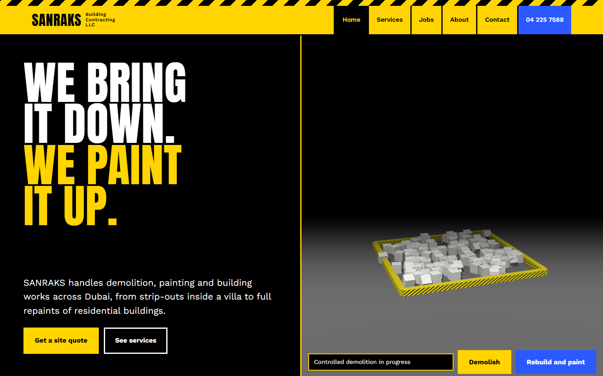
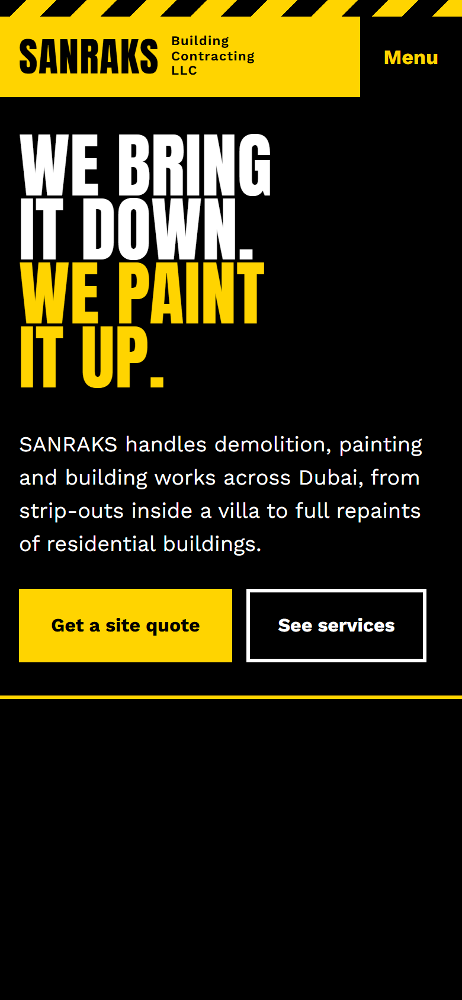
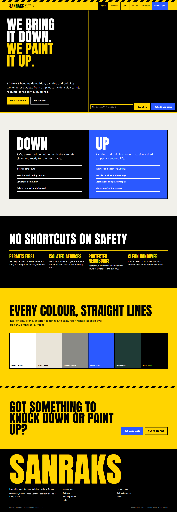

# SANRAKS Building Contracting LLC

A bold, industrial multi-page static concept website for **SANRAKS Building Contracting LLC**, a Dubai contractor handling **demolition, interior strip-outs, painting, and building repair works** from Festival City, Ras Al Khor, Dubai.

Styled with high-contrast **hazard-yellow, pitch-black, concrete-grey, and signal-blue** brutalist typography (`Anton` + `Work Sans`), the site features an interactive **Three.js 3D concrete tower** enclosed by hazard-striped barriers that users can **demolish** and **rebuild in fresh paint colors** on demand.

---

## Screenshots

### Desktop — Interactive 3D Demolition & Paint Hero


### Pages & Responsive Views

| Services | Jobs Showcase |
| :---: | :---: |
|  |  |

| Get a Site Quote | Mobile Responsive (`390×844`) |
| :---: | :---: |
|  |  |

<details>
<summary>View Full Landing Page Screenshot</summary>



</details>

---

## Key Features

- **Interactive Three.js 3D Demolition & Rebuild Scene (`assets/js/scene.js`)**:
  - Built with bundled **Three.js r128** (`assets/js/vendor/three.min.js`) with shadow mapping and procedural hazard-stripe canvas textures.
  - Renders a multi-storey concrete tower inside a yellow-and-black hazard barrier.
  - **Interactive Controls**:
    - Click the **Demolish** button (`[data-demolish]`) or click directly on the 3D tower to trigger structural collapse with live status feedback (`[data-demo-status]`).
    - Click **Rebuild and paint** (`[data-rebuild]`) to reconstruct the tower in fresh architectural paint colors.
  - Includes clickable `data-scene="mini"` canvases on inner pages and respects `prefers-reduced-motion`.
- **Two-Trades Split Layout**: Contrasts **Down** (strip-outs, partition removal, structural demolition, debris disposal) against **Up** (interior/exterior painting, facade coatings, block/plaster repair, waterproofing).
- **Safety & Paint Swatches**: Dedicated safety standards section (permits, isolated services, hoarding/dust screens, clean handover) and interactive-feeling paint color swatch strip.
- **Validated Site Quote Form (`assets/js/main.js`)**: Client-side validation with accessible `aria-live` feedback.
- **Zero Build Step**: Pure HTML5, CSS3, and vanilla JavaScript.

---

## Pages Included

| File | Page | Highlights |
| :--- | :--- | :--- |
| `index.html` | **Home** | Interactive 3D demolish/rebuild tower, Down vs. Up trades, safety principles, paint swatches |
| `services.html` | **Services** | Demolition (Strip-out, Structural, Disposal), Painting (Interior, Facade, Epoxy/Textured), Building Works |
| `projects.html` | **Jobs** | 6 sample job cards tagged `Down` / `Up` (office strip-out, villa repaint, annexe demolition, G+4 facade, warehouse epoxy, shell reset) |
| `about.html` | **About** | Combined demolition + painting value proposition and 5-step job execution flow |
| `contact.html` | **Get a site quote** | Festival City office details, quote request form, embedded Google Map |
| `404.html` | **Not Found** | Custom brutalist 404 page (`Nothing here`) |

---

## Design System & Typography

- **Fonts**: `Anton` (condensed uppercase industrial display) and `Work Sans` (body & UI) via Google Fonts.
- **Color Tokens** (`assets/css/style.css`):
  - Hazard Yellow: `#FFD400`
  - Pitch Black: `#000000`
  - Concrete Grey: `#8A8A85`
  - Signal Blue: `#2B59FF`
  - Warm Paper: `#F1F0EA`
  - Hazard Stripe Pattern: `repeating-linear-gradient(-45deg, #FFD400 0 18px, #000000 18px 36px)`

---

## Project Structure

```text
sanraks-demolition-painting/
├── index.html
├── services.html
├── projects.html
├── about.html
├── contact.html
├── 404.html
├── favicon.svg
├── screenshots/
│   ├── home-hero.png
│   ├── home-full.png
│   ├── services.png
│   ├── projects.png
│   ├── contact.png
│   └── mobile-home.png
└── assets/
    ├── css/
    │   └── style.css
    └── js/
        ├── main.js
        ├── scene.js
        └── vendor/
            └── three.min.js
```

---

## Run Locally

No build tools or package manager setup required:

```bash
git clone https://github.com/hassaankhalid225/sanraks-demolition-painting.git
cd sanraks-demolition-painting

# Using Node.js
npx serve .

# Or using Python
python -m http.server 8000
```

---

## Deployment & Form Setup

- **Static Hosting**: Deploy directly to **Vercel**, **Netlify**, or **GitHub Pages** with an empty build command and `.` as the output directory.
- **Connecting Email Form Submissions**: To forward quote requests to an email service such as Formspree, add `action` and `method="POST"` to the `<form>` in `contact.html` and remove `data-contact-form`.

---

## Notes

- Contact details (`Office 103, Sky Business Centre, Festival City, Ras Al Khor, Dubai`, `04 225 7588`) come from public business directory listings.
- Sample job cards are illustrative concept content for review.
